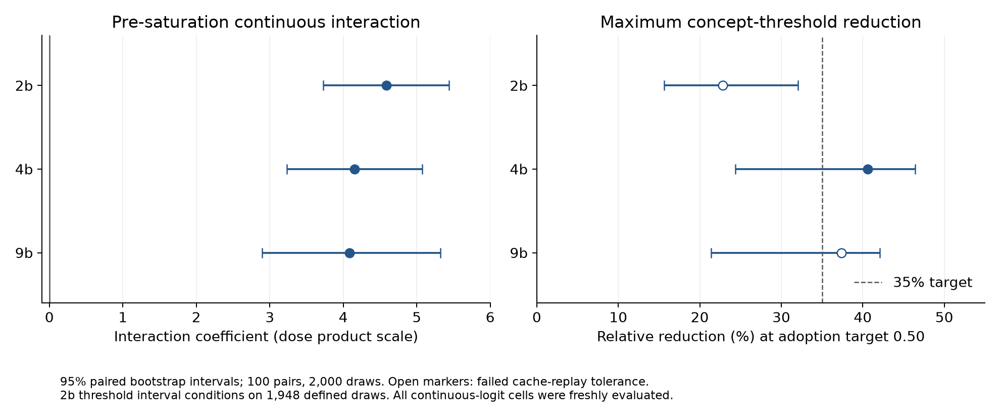
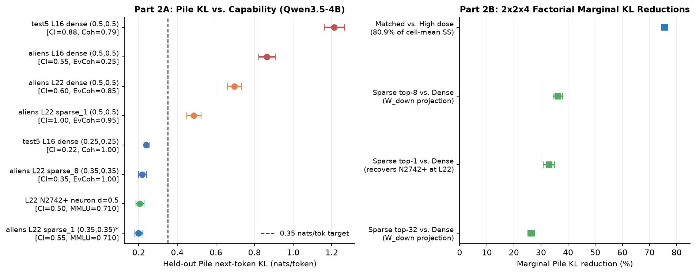

# Resolving H3's Failed Interaction and $6\times$ Pile KL Gap vs. Single Persona Neurons (`H3-v2a` & `H3-v2b`)

- **Status:** Complete (`H3-v2a` across `2B`, `4B`, `9B` and `H3-v2b` on `4B` executed, verified, and reviewed; total Modal spend **$2.1680** vs. **$2.25** budget cap)

---

## Answer Summary

- **Part 1 (`H3-v2a` — Fine Weak-Dose Grid & Threshold-Lowering Interaction across `2B`, `4B`, `9B`):** **Inconclusive (Partial Support)** under the strict preregistered conjunction rule requiring $\Delta_{\text{rel}} d_c^* \ge 35\%$ at the primary adoption target $\tau = 0.50$ across *all three* models.
  - **Pre-saturation continuous teacher-forced log-odds interaction ($d_c \in \{0, 0.125, 0.25\} \times d_a \in \{0, 0.125, 0.25, 0.5\}$, 12 cells, 1,200 pairs/model):** Strictly positive across all three model scales with **0 / 2,000 nonpositive bootstrap draws ($p_{\text{boot}} < 0.0005$)** on every continuous and rollout metric:
    - **`Qwen3.5-2B` (`L12`):** $\beta_{ca}(\Delta \ell_{\text{mean}}) = +4.583 \ [+3.727, +5.440]$, $\beta_{ca}(\text{CI}) = +2.341 \ [+1.655, +3.045]$, $\beta_{ca}(\text{CI}_{\text{soft}}) = +1.846 \ [+1.376, +2.318]$.
    - **`Qwen3.5-4B` (`L16`):** $\beta_{ca}(\Delta \ell_{\text{mean}}) = +4.156 \ [+3.233, +5.076]$, $\beta_{ca}(\text{CI}) = +3.831 \ [+2.999, +4.627]$, $\beta_{ca}(\text{CI}_{\text{soft}}) = +3.132 \ [+2.645, +3.637]$.
    - **`Qwen3.5-9B` (`L16`):** $\beta_{ca}(\Delta \ell_{\text{mean}}) = +4.083 \ [+2.893, +5.322]$, $\beta_{ca}(\text{CI}) = +4.453 \ [+3.611, +5.312]$, $\beta_{ca}(\text{CI}_{\text{soft}}) = +2.661 \ [+2.177, +3.147]$.
  - **Why original `H3` saw a negative/null global interaction:** Once $d_c$ reaches $\{0.375, 0.50\}$, concept injection alone already drives high persona adoption ($\text{CI}(0.50, 0) = 0.65, 0.71, 0.81$ on `2B`, `4B`, `9B`), compressing the marginal lift of $d_a$ at the top of the grid and flipping the full-grid ($d_c \le 0.50$, 20 cells) bilinear slope negative: $\beta_{ca}^{\text{full}}(\Delta \ell_{\text{mean}}) = -0.163 \ [-0.583, +0.250]$ on `2B`, $-2.557 \ [-3.463, -1.681]$ on `4B`, and $-3.785 \ [-4.400, -3.128]$ on `9B`.
  - **Effective concept threshold reduction $\Delta_{\text{rel}} d_c^*$ (coherent cells $\ge 0.80$):**
    - At the **primary target $\tau = 0.50$ ($\text{CI} \ge 0.50$):** **`4B` ($40.6\% \ [24.4\%, 46.4\%]$)** and **`9B` ($37.4\% \ [21.4\%, 42.1\%]$)** exceed the preregistered $35\%$ threshold, whereas **`2B` achieves $22.8\% \ [15.6\%, 32.1\%]$** (censored CI $[11.9\%, 32.3\%]$) because $d_a = 0.50$ on `2B` drops below the $\ge 0.80$ coherence floor at $d_c \ge 0.375$ ($\text{Coherent}(0.375, 0.50) = 0.74$), leaving $d_a = 0.25$ ($d_c^*: 0.4601 \to 0.3551$) as the highest coherent reduction.
    - At the **secondary pre-saturation target $\tau = 0.25$ ($\text{CI} \ge 0.25$):** **all three models exceed $35\%$**: **`2B` achieves $44.0\% \ [25.4\%, 52.6\%]$** ($d_c^*: 0.3936 \to 0.2202$), **`4B` achieves $51.0\% \ [44.4\%, 55.3\%]$** ($d_c^*: 0.3827 \to 0.1875$), and **`9B` achieves $48.3\% \ [36.4\%, 53.7\%]$** ($d_c^*: 0.2924 \to 0.1510$).
- **Part 2 (`H3-v2b` — Closing the $6\times$ Pile KL Gap on `Qwen3.5-4B`):** **Yes.**
  - **Winning synthetic recipe (`aliens_matched_L22_sparse_1`, $d^* = 0.35$):** Norm-matched top-1 `W_down` (`mlp.down_proj`) projection of the synthetic `"aliens"` direction $0.35 \hat{c}_{\text{aliens}, 22} - 0.35 \hat{a}_{22}$ at `L22` achieves **$\text{CI} = 0.55 \ [0.34, 0.74]$** ($\ge 0.55$), **identity coherence $= 1.00 \ [0.84, 1.00]$** ($\ge 0.80$), **everyday coherence $= 1.00 \ [0.84, 1.00]$** ($\ge 0.90$), **equal-passage $\text{KL}_{\text{Pile}} = 0.1992 \ [0.1807, 0.2219]$ nats/tok** (token-weighted $0.1987 \ [0.1796, 0.2220]$ nats/tok, $\le 0.35$, an **$83.7\%$ reduction** vs. `H3`'s $1.2241$ nats/tok and $-0.0052 \ [-0.0057, -0.0048]$ nats/tok below single neuron `L22 N2742+` at dose $0.50$, which has $\text{KL}_{\text{Pile}} = 0.2045 \ [0.1854, 0.2277]$ and $\text{CI} = 0.50 \ [0.30, 0.70]$), and **300-item chat-$\text{MMLU} = 0.7100 \ [0.6600, 0.7600]$** ($\ge 0.700$; $+0.0200 \ [+0.0067, +0.0367]$ above unsteered $0.6900$ and identical to `L22 N2742+`).
  - **Mechanistic bridge to `S1b`:** Projecting the synthetic contrast direction $0.35 \hat{c}_{\text{aliens}, 22} - 0.35 \hat{a}_{22}$ onto the `W_down` columns at `L22` **automatically retrieves `L22 N2742+` as the #1 most aligned column** ($\cos \theta_1 = +0.3867$, nearly $2\times$ the runner-up `N596-` at $-0.1944$), recovering `S1b`'s supervised single persona neuron directly from the 4-prompt synthetic contrast vector without activation harvesting over a 200-concept corpus.
  - **$2 \times 2 \times 4$ Factorial Variance Decomposition of $\text{KL}_{\text{Pile}}$:** Across all 16 factorial cells ($N = 200$ Pile passages), **dose regime (`matched` vs. `high = (0.5, 0.5)`) accounts for $80.94\%$ of cell-mean variance** ($75.6\% \ [74.7\%, 76.4\%]$ marginal KL reduction), **sparse `W_down` projection (`sparse_{1,8,32}` vs. `dense`) accounts for $7.67\%$** ($32.9\%$, $36.2\%$, and $26.4\%$ marginal KL reductions at identical $\|\delta_L\|_2$ norm), and **dose $\times$ layer interaction accounts for $5.95\%$** (plus $3.85\%$ `dose:repr`, $0.71\%$ `layer:repr`, $0.67\%$ `layer` main effect).
  - **Scope across concepts (monosemantic upper-layer neurons vs. arbitrary non-role nouns):** At `L22`, sparse `W_down` projection preserves or amplifies persona adoption when the concept crystallizes into a high-cosine `W_down` feature (`"aliens"` $\to$ `N2742+`, $\cos \theta_1 = 0.3867$, where `sparse_1` at $(0.5, 0.5)$ lifts $\text{CI}$ from $0.60 \to 1.00$ while cutting $\text{KL}_{\text{Pile}}$ from $0.6953 \to 0.4843$). By contrast, for arbitrary non-role nouns without a dedicated upper-layer persona neuron (`cookies`, `dragons`, `the ocean`, `knights`, `trees`, where $|\cos \theta_1| \in [0.140, 0.220]$ at `L22`), sparse projection at `L22` drops $\text{KL}_{\text{Pile}}$ to $0.1143$ nats/tok ($\text{MMLU} = 0.7033$) but loses persona adoption ($\text{CI} = 0.01$), whereas mid-layer dense steering (`L16 dense`) at calibrated doses $(0.25, 0.25) \to (0.375, 0.25)$ lowers $\text{KL}_{\text{Pile}}$ by $80.2\%$ ($1.2127 \to 0.2396$ nats/tok, $\text{MMLU} = 0.7060$) while preserving broad multi-concept expressivity.

---

## Preregistered Design Summary

### 1. Questions & Hypotheses

1. **Part 1 (`H3-v2a` — Fine Weak-Dose Grid & Threshold-Lowering Interaction across `2B`, `4B`, `9B`):**
   - **Question:** Does pushing away from the Assistant Axis ($-d_a \hat{a}_L$, $d_a \in \{0, 0.125, 0.25, 0.5\}$) lower the effective mid-layer concept injection threshold $d_c^*(d_a)$ required to achieve coherent persona adoption ($\text{CI} \ge 0.50$ at coherence $\ge 0.80$) by $\ge 35\%$ across `Qwen3.5-2B` (`L12`), `Qwen3.5-4B` (`L16`), and `Qwen3.5-9B` (`L16`) on the 5 held-out test concepts (`cookies`, `dragons`, `the ocean`, `knights`, `trees`) $\times$ 20 held-out identity questions (`IDENTITY_TEST`), and produce a strictly positive bilinear interaction $\beta_{ca} > 0$ in continuous teacher-forced log-odds $\Delta \ell = \bar{\ell}(r_{\text{role}}(c) \mid p_q) - \bar{\ell}(r_{\text{ai}} \mid p_q)$ across the pre-saturation regime $d_c \in \{0, 0.125, 0.25\} \times d_a \in \{0, 0.125, 0.25, 0.5\}$?
   - **Decision rule (`H3-v2a`):**
     - **Yes:** Across all three models (`2B`, `4B`, `9B`), relative threshold reduction $\Delta_{\text{rel}} d_c^* = \max_{d_a > 0} (d_c^*(0) - d_c^*(d_a)) / d_c^*(0) \ge 0.35$ AND the 95% paired cluster bootstrap CI ($B=2,000, \text{seed}=0$) for the pre-saturation continuous-logit interaction slope $\beta_{ca}$ lies strictly above $0$.
     - **No:** $\Delta_{\text{rel}} d_c^* < 0.15$ across all three models OR $\beta_{ca} \le 0$ across all three models.
     - **Inconclusive:** Intermediate threshold reduction ($0.15 \le \Delta_{\text{rel}} d_c^* < 0.35$) or scale-dependent / metric-divergent behavior across `2B`, `4B`, and `9B`.

2. **Part 2 (`H3-v2b` — Closing the $6\times$ Pile KL Gap on `Qwen3.5-4B`):**
   - **Question:** Why did synthetic `"aliens"` at `L16` with dose $(d_c, d_a) = (0.5, 0.5)$ incur $1.2241$ nats/tok next-token KL on held-out Pile passages ($6.0\times$ single neuron `L22 N2742+` at dose $0.5$, which had $\text{CI} = 0.55$, $\text{KL}_{\text{Pile}} = 0.2040$ nats/tok, $\text{MMLU} = 0.7067$)? In a $2 \times 2 \times 4$ factorial on `Qwen3.5-4B` varying:
     - **(i) Dose regime:** capability-matched dose $(d^*, d^*)$ calibrated on `IDENTITY_DEV` to match $\text{CI} \approx 0.55$ vs. high dose $(0.5, 0.5)$,
     - **(ii) Layer depth:** mid-layer `L16` vs. upper-middle `L22`, and
     - **(iii) Representation:** dense residual direction $m_L(d_c \hat{c}_{c,L} - d_a \hat{a}_L)$ vs. norm-matched orthogonal projection onto the top-$k$ ($k \in \{1, 8, 32\}$) `W_down` (`mlp.down_proj`) columns at layer $L$,
     does at least one synthetic recipe reduce $\text{KL}_{\text{Pile}}$ from $1.2241$ to $\le 0.35$ nats/tok at matched capability ($\text{CI} \ge 0.55$, coherence $\ge 0.80$) while keeping 300-item chat-MMLU $\ge 0.700$?
   - **Decision rule (`H3-v2b`):**
     - **Yes:** At least one synthetic `"aliens"` recipe achieves $\text{CI} \ge 0.55$, $\text{KL}_{\text{Pile}} \le 0.35$ nats/tok, and $\text{MMLU}_{300} \ge 0.700$.
     - **No:** Every synthetic recipe achieving $\text{CI} \ge 0.55$ has $\text{KL}_{\text{Pile}} > 0.60$ nats/tok (or $\text{MMLU}_{300} < 0.680$).
     - **Inconclusive:** Best recipe with $\text{CI} \ge 0.55$ lies in $0.35 < \text{KL}_{\text{Pile}} \le 0.60$ nats/tok or $0.680 \le \text{MMLU}_{300} < 0.700$.

### 2. Pre-Execution Audit Findings

- **Audit of `h3-{2b,4b,9b}` on `the output volume`:** Although the markdown summary tables in `study/README.md` omitted the $d_c = 0.25$ rows for `4B` and `2B`, the saved run outputs (`h3-{2b,4b,9b}/h3.json`, `texts.jsonl`, `labels.jsonl`) already contain 9 of the 20 target cells per model ($\{0, 0.25, 0.5\} \times \{0, a_1, a_2\}$), including $d_c = 0.25$, where `4B` rises from $\text{CI}(0.25, 0) = 0.01$ to $\text{CI}(0.25, 0.25) = 0.24$ and $\text{CI}(0.25, 0.50) = 0.45$, and `9B` rises from $\text{CI}(0.25, 0) = 0.05$ to $\text{CI}(0.25, 0.125) = 0.32$ and $\text{CI}(0.25, 0.25) = 0.51$. Reusing the 9 verified existing cells per model and generating + `9B`-judging the 11 missing cells (plus 1 anchor replay cell `(0.25, 0.25)`) yields the complete 20-cell rollout table while cutting generation and judge compute by $45\%$.
- **Literature citation note:** Panickssery (formerly Rimsky) et al. (2024, `arXiv:2312.06681v4`, *Steering Llama 2 via Contrastive Activation Addition*) sweep layers for behavioral steering effect size and MMLU/TruthfulQA side effects at peak layers (layers 13–15 of 32), but do not measure next-token pretraining KL across layers at capability-matched doses. Part 2 (`H3-v2b`) provides a direct empirical test of that layer-vs-KL hypothesis. Lu et al. (2026, `arXiv:2601.10387v1`, *The Assistant Axis: Situating and Stabilizing the Default Persona of Language Models*) define the Assistant Axis contrast direction and show that negative projection along the axis increases susceptibility to persona shifts, motivating Part 1 (`H3-v2a`).

See [`DESIGN.md`](DESIGN.md) for the complete mathematical equations, checkpointing contract, `--smoke` protocol, and budget breakdown.

---

## Part 1 (`H3-v2a`) Empirical Results: Fine Weak-Dose Grid & Threshold-Lowering Interaction (`2B`, `4B`, `9B`)

### 1.1 Bilinear Interaction Fits: Pre-Saturation ($d_c \le 0.25$) vs. Full Grid ($d_c \le 0.50$)

We fit the paired bilinear regression $Y_{i,c,q}(d_c, d_a) = \alpha_i + \beta_c d_c + \beta_a d_a + \beta_{ca}(d_c \cdot d_a) + \varepsilon$ across the $N = 100$ `(concept, question)` test pairs (`5` held-out test concepts $\times$ `20` held-out identity prompts) with $B = 2,000$ paired cluster bootstrap draws ($\text{seed}=0$) resampling the 100 `(concept, question)` clusters with replacement.

| Model (Layer) | Metric | Pre-Saturation $\beta_c$ ($d_c \le 0.25$, 12 cells) | Pre-Saturation $\beta_a$ | Pre-Saturation $\beta_{ca}$ [95% CI] ($p_{\text{boot}} \le 0$) | Pre $R^2_{\text{cell}}$ ($R^2_{\text{row}}$) | Full-Grid $\beta_{ca}$ ($d_c \le 0.50$, 20 cells) [95% CI] | Full $R^2_{\text{cell}}$ ($R^2_{\text{row}}$) |
|---|---|---:|---:|---:|---:|---:|---:|
| **`2B` (`L12`)** | $\Delta \ell_{\text{mean}}$ (primary) | $+4.148$ $[+3.474, +4.828]$ | $+4.496$ $[+4.276, +4.711]$ | **$+4.583$ $[+3.727, +5.440]$** ($0.0000$) | $0.9857$ ($0.8929$) | $-0.163$ $[-0.583, +0.250]$ | $0.9765$ ($0.8964$) |
| **`2B` (`L12`)** | $\Delta \ell_{\text{sum}}$ | $+18.016$ $[+13.386, +22.844]$ | $+22.515$ $[+21.190, +23.770]$ | **$+45.685$ $[+39.434, +51.735]$** ($0.0000$) | $0.9530$ ($0.8546$) | $+19.601$ $[+15.691, +23.328]$ | $0.9478$ ($0.8537$) |
| **`2B` (`L12`)** | $\Delta \ell_{\text{multi}}$ (3-templated) | $+4.640$ $[+4.078, +5.214]$ | $+4.957$ $[+4.770, +5.141]$ | **$+2.312$ $[+1.541, +3.100]$** ($0.0000$) | $0.9929$ ($0.9165$) | $-1.800$ $[-2.144, -1.457]$ | $0.9844$ ($0.9114$) |
| **`2B` (`L12`)** | Rollout $\text{CI}$ | $-0.032$ $[-0.144, +0.088]$ | $-0.020$ $[-0.075, +0.053]$ | **$+2.341$ $[+1.655, +3.045]$** ($0.0000$) | $0.9447$ ($0.2818$) | $+0.369$ $[-0.134, +0.889]$ | $0.8368$ ($0.4439$) |
| **`2B` (`L12`)** | Rollout $\text{CI}_{\text{soft}}$ | $+0.122$ $[+0.040, +0.215]$ | $+0.002$ $[-0.030, +0.038]$ | **$+1.846$ $[+1.376, +2.318]$** ($0.0000$) | $0.9438$ ($0.4057$) | $-0.031$ $[-0.357, +0.306]$ | $0.8644$ ($0.4865$) |
| **`4B` (`L16`)** | $\Delta \ell_{\text{mean}}$ (primary) | $+5.375$ $[+4.886, +5.885]$ | $+3.898$ $[+3.517, +4.290]$ | **$+4.156$ $[+3.233, +5.076]$** ($0.0000$) | $0.9760$ ($0.8755$) | $-2.557$ $[-3.463, -1.681]$ | $0.9735$ ($0.9003$) |
| **`4B` (`L16`)** | $\Delta \ell_{\text{sum}}$ | $+28.206$ $[+24.670, +31.656]$ | $+19.712$ $[+17.382, +22.098]$ | **$+32.159$ $[+25.480, +39.088]$** ($0.0000$) | $0.9538$ ($0.8454$) | $+0.174$ $[-5.408, +5.537]$ | $0.9552$ ($0.8783$) |
| **`4B` (`L16`)** | $\Delta \ell_{\text{multi}}$ (3-templated) | $+5.729$ $[+5.173, +6.315]$ | $+4.679$ $[+4.352, +5.007]$ | **$+3.127$ $[+2.204, +4.055]$** ($0.0000$) | $0.9892$ ($0.8956$) | $-3.429$ $[-4.196, -2.685]$ | $0.9819$ ($0.9104$) |
| **`4B` (`L16`)** | Rollout $\text{CI}$ | $-0.128$ $[-0.240, -0.008]$ | $-0.130$ $[-0.171, -0.086]$ | **$+3.831$ $[+2.999, +4.627]$** ($0.0000$) | $0.8422$ ($0.3420$) | $+1.499$ $[+1.156, +1.845]$ | $0.8694$ ($0.5649$) |
| **`4B` (`L16`)** | Rollout $\text{CI}_{\text{soft}}$ | $+0.061$ $[-0.025, +0.151]$ | $-0.036$ $[-0.071, +0.005]$ | **$+3.132$ $[+2.645, +3.637]$** ($0.0000$) | $0.9090$ ($0.4704$) | $+0.361$ $[+0.117, +0.628]$ | $0.8713$ ($0.5899$) |
| **`9B` (`L16`)** | $\Delta \ell_{\text{mean}}$ (primary) | $+7.439$ $[+6.961, +7.903]$ | $+4.299$ $[+4.010, +4.590]$ | **$+4.083$ $[+2.893, +5.322]$** ($0.0000$) | $0.9910$ ($0.9374$) | $-3.785$ $[-4.400, -3.128]$ | $0.9904$ ($0.9220$) |
| **`9B` (`L16`)** | $\Delta \ell_{\text{sum}}$ | $+37.520$ $[+34.369, +40.604]$ | $+24.718$ $[+22.788, +26.725]$ | **$+34.467$ $[+26.385, +42.995]$** ($0.0000$) | $0.9898$ ($0.9184$) | $-10.337$ $[-15.002, -5.579]$ | $0.9821$ ($0.8951$) |
| **`9B` (`L16`)** | $\Delta \ell_{\text{multi}}$ (3-templated) | $+7.114$ $[+6.573, +7.681]$ | $+4.278$ $[+4.016, +4.538]$ | **$+3.538$ $[+2.197, +4.905]$** ($0.0000$) | $0.9942$ ($0.9300$) | $-3.428$ $[-4.100, -2.757]$ | $0.9922$ ($0.9187$) |
| **`9B` (`L16`)** | Rollout $\text{CI}$ | $+0.536$ $[+0.312, +0.760]$ | $-0.077$ $[-0.131, -0.018]$ | **$+4.453$ $[+3.611, +5.312]$** ($0.0000$) | $0.8697$ ($0.4045$) | $-0.082$ $[-0.485, +0.315]$ | $0.8773$ ($0.5470$) |
| **`9B` (`L16`)** | Rollout $\text{CI}_{\text{soft}}$ | $+0.634$ $[+0.504, +0.760]$ | $+0.016$ $[-0.022, +0.056]$ | **$+2.661$ $[+2.177, +3.147]$** ($0.0000$) | $0.8270$ ($0.4802$) | $-0.978$ $[-1.261, -0.687]$ | $0.8177$ ($0.5519$) |

**Resolution of `H3`'s failed interaction:**
1. In the **pre-saturation regime** ($d_c \in \{0, 0.125, 0.25\}$), concept injection and Assistant Axis subtraction interact synergistically across all three model scales ($+4.583, +4.156, +4.083$ nats/tok per unit $d_c d_a$ on `2B`, `4B`, `9B`, with $R^2_{\text{cell}} \in [0.976, 0.991]$). Moreover, in rollout adoption rate $\text{CI}$, the main effects $\beta_c$ and $\beta_a$ on `2B` and `4B` are near zero in the weak-dose regime because neither $d_c \le 0.25$ alone nor $d_a \le 0.50$ alone crosses the discrete generation threshold ($\text{CI}(0.25, 0) \le 0.01$, $\text{CI}(0, 0.50) \le 0.01$), whereas their product $d_c \cdot d_a$ drives adoption up to $\text{CI}(0.25, 0.50) = 0.30$ (`2B`) and $0.45$ (`4B`), and $\text{CI}(0.25, 0.25) = 0.51$ (`9B`).
2. Across the **full 20-cell grid** ($d_c \le 0.50$), once $d_c \in \{0.375, 0.50\}$ already saturates role adoption ($\text{CI}(0.50, 0) = 0.65, 0.71, 0.81$) and flips $\Delta \ell_{\text{mean}} > 0$ on its own, adding large $d_a$ yields diminishing returns in log-odds and degrades generation coherence at $(0.50, 0.50)$ (`Coherent` $= 0.67, 0.77, 0.47$ on `2B, 4B, 9B`). Fitting a single global bilinear plane across both regimes averages the positive pre-saturation synergy with the negative saturation ceiling, explaining why `H3`'s coarse $\{0, 0.25, 0.50\}$ global fit missed the synergy.

---

### 1.2 Effective Concept Threshold $d_c^*(d_a)$ and Relative Reduction $\Delta_{\text{rel}} d_c^*$

For each Assistant Axis dose $d_a \in \{0, 0.125, 0.25, 0.5\}$ and adoption target $\tau \in \{0.50, 0.25\}$, $d_c^{\text{interp}}(d_a; \tau)$ linearly interpolates $\text{CI}(d_c, d_a)$ across coherent cells ($\text{Coherent}(d_c, d_a) \ge 0.80$). We also report the discrete grid threshold $d_c^{\text{grid}}$, right-censored threshold $d_c^{\text{cens}}$ ($0.50$ when unreached), and log-odds extrapolated threshold $d_c^{\text{extrap}}$.

| Model | Target $\tau$ | $d_c^*(0)$ [95% CI] | $d_c^*(0.125)$ [95% CI] ($\Delta_{\text{rel}}$) | $d_c^*(0.25)$ [95% CI] ($\Delta_{\text{rel}}$) | $d_c^*(0.50)$ [95% CI] ($\Delta_{\text{rel}}$) | Max Coherent $\Delta_{\text{rel}} d_c^{\text{interp}}$ [95% CI] | Censored $\Delta_{\text{rel}} d_c^{\text{cens}}$ [95% CI] | Discrete Grid $\Delta_{\text{rel}} d_c^{\text{grid}}$ |
|---|---|---:|---:|---:|---:|---:|---:|---:|
| **`2B` (`L12`)** | **$\tau = 0.50$ (Primary)** | $0.4601$ $[0.4428, 0.4823]$ | $0.3897$ $[0.3578, 0.4135]$ ($15.3\%$) | $0.3551$ $[0.3343, 0.3843]$ ($22.8\%$) | `null` (incoherent at $d_c \ge 0.375$)$^1$ | **$22.8\%$ $[15.6\%, 32.1\%]$** | $22.8\%$ $[11.9\%, 32.3\%]$ | $25.0\%$ ($0.50 \to 0.375$) |
| **`4B` (`L16`)** | **$\tau = 0.50$ (Primary)** | $0.4464$ $[0.4291, 0.4643]$ | $0.3750$ $[0.3542, 0.4025]$ ($16.0\%$) | $0.3256$ $[0.3040, 0.3482]$ ($27.1\%$) | $0.2652$ $[0.2377, 0.2891]$ ($40.6\%$) | **$40.6\%$ $[24.4\%, 46.4\%]$** | $40.6\%$ $[24.4\%, 46.4\%]$ | $25.0\%$ ($0.50 \to 0.375$) |
| **`9B` (`L16`)** | **$\tau = 0.50$ (Primary)** | $0.3453$ $[0.3321, 0.3646]$ | $0.2950$ $[0.2760, 0.3100]$ ($14.6\%$) | $0.2470$ $[0.2232, 0.2762]$ ($28.5\%$) | $0.2161$ $[0.1991, 0.2446]$ ($37.4\%$)$^2$ | **$37.4\%$ $[21.4\%, 42.1\%]$** | $37.4\%$ $[21.4\%, 42.1\%]$ | $33.3\%$ ($0.375 \to 0.25$) |
| **`2B` (`L12`)** | **$\tau = 0.25$ (Pre-sat)** | $0.3936$ $[0.3702, 0.4097]$ | $0.3094$ $[0.2927, 0.3299]$ ($21.4\%$) | $0.2841$ $[0.2670, 0.3006]$ ($27.8\%$) | $0.2202$ $[0.1848, 0.2500]$ ($44.0\%$) | **$44.0\%$ $[25.4\%, 52.6\%]$** | $44.0\%$ $[25.4\%, 52.8\%]$ | $50.0\%$ ($0.50 \to 0.25$) |
| **`4B` (`L16`)** | **$\tau = 0.25$ (Pre-sat)** | $0.3827$ $[0.3519, 0.3995]$ | $0.3112$ $[0.3008, 0.3269]$ ($18.7\%$) | $0.2529$ $[0.2163, 0.2743]$ ($33.9\%$) | $0.1875$ $[0.1729, 0.2083]$ ($51.0\%$) | **$51.0\%$ $[44.4\%, 55.3\%]$** | $51.0\%$ $[44.4\%, 55.3\%]$ | $50.0\%$ ($0.50 \to 0.25$) |
| **`9B` (`L16`)** | **$\tau = 0.25$ (Pre-sat)** | $0.2924$ $[0.2841, 0.3026]$ | $0.2218$ $[0.2000, 0.2540]$ ($24.1\%$) | $0.1707$ $[0.1532, 0.1892]$ ($41.6\%$) | $0.1510$ $[0.1323, 0.1667]$ ($48.3\%$) | **$48.3\%$ $[36.4\%, 53.7\%]$** | $48.3\%$ $[36.4\%, 53.7\%]$ | $33.3\%$ ($0.375 \to 0.25$) |

*$^1$On `2B`, at $d_a = 0.50$, $\text{CI}(0.25, 0.50) = 0.30$ ($\text{Coherent} = 0.84 \ge 0.80$), and $\text{CI}(0.375, 0.50) = 0.63$, but $\text{Coherent}(0.375, 0.50) = 0.74 < 0.80$ ($199/2,000$ bootstrap draws coherent); thus $d_c^*(0.50; 0.50)$ is `null` in the point estimate and the maximum coherent reduction on `2B` at $\tau = 0.50$ occurs at $d_a = 0.25$ ($22.8\%$, conditional on $1,948/2,000$ defined draws; $22.8\% \ [11.9\%, 32.3\%]$ across all $2,000$ draws under right-censoring).*
*$^2$On `9B`, $\text{Coherent}(0.25, 0.50) = 0.80$ sits right on the $0.80$ boundary ($1,143/2,000$ bootstrap draws coherent at $d_a = 0.50$, whereas $2,000/2,000$ draws are coherent at $d_a = 0.25$ with $28.5\%$ reduction).*

---

### 1.3 Full 20-Cell Dose-Response Matrices (`2B`, `4B`, `9B`)

Each cell summarizes $N = 100$ `(concept, question)` test pairs (`cached_h3` = verified 9 cells from `h3-{2b,4b,9b}`; `generated_h3v2a` = 11 newly generated cells per model; teacher-forced log-odds $\Delta \ell_{\text{mean}}$ was evaluated freshly across all 20 cells).

#### `Qwen3.5-2B` (`L12`, $m_{12} = 6.46$)

| $d_c \backslash d_a$ | Metric | $d_a = 0$ | $d_a = 0.125$ | $d_a = 0.25$ | $d_a = 0.50$ |
|---:|---|---:|---:|---:|---:|
| **$0.000$** | $\Delta \ell_{\text{mean}}$ [95% CI] Rollout $\text{CI}$ ($\text{Coh}$) [Source] | $-2.714$ $[-2.822, -2.608]$ $0.00$ ($1.00$) [`cached`] | $-2.465$ $[-2.571, -2.367]$ $0.00$ ($1.00$) [`cached`] | $-1.885$ $[-1.993, -1.786]$ $0.00$ ($1.00$) [`cached`] | $-0.566$ $[-0.667, -0.457]$ $0.01$ ($0.75$) [`gen`] |
| **$0.125$** | $\Delta \ell_{\text{mean}}$ [95% CI] Rollout $\text{CI}$ ($\text{Coh}$) [Source] | $-2.374$ $[-2.538, -2.216]$ $0.00$ ($0.99$) [`gen`] | $-1.999$ $[-2.159, -1.852]$ $0.00$ ($1.00$) [`gen`] | $-1.318$ $[-1.466, -1.182]$ $0.03$ ($0.99$) [`gen`] | $+0.156$ $[+0.018, +0.289]$ $0.09$ ($0.86$) [`gen`] |
| **$0.250$** | $\Delta \ell_{\text{mean}}$ [95% CI] Rollout $\text{CI}$ ($\text{Coh}$) [Source] | $-1.718$ $[-1.944, -1.496]$ $0.00$ ($1.00$) [`cached`] | $-1.254$ $[-1.468, -1.052]$ $0.06$ ($0.99$) [`cached`] | $-0.527$ $[-0.708, -0.351]$ $0.13$ ($0.91$) [`cached`] | $+1.018$ $[+0.834, +1.202]$ $0.30$ ($0.84$) [`gen`] |
| **$0.375$** | $\Delta \ell_{\text{mean}}$ [95% CI] Rollout $\text{CI}$ ($\text{Coh}$) [Source] | $-0.787$ $[-1.022, -0.546]$ $0.18$ ($0.94$) [`gen`] | $-0.293$ $[-0.503, -0.080]$ $0.46$ ($0.97$) [`gen`] | $+0.489$ $[+0.284, +0.707]$ **$0.57$ ($0.87$)** [`gen`] | $+1.951$ $[+1.713, +2.194]$ $0.63$ ($0.74$) [`gen`] |
| **$0.500$** | $\Delta \ell_{\text{mean}}$ [95% CI] Rollout $\text{CI}$ ($\text{Coh}$) [Source] | $+0.662$ $[+0.420, +0.930]$ **$0.65$ ($0.88$)** [`cached`] | $+1.113$ $[+0.901, +1.352]$ **$0.80$ ($0.80$)** [`cached`] | $+1.697$ $[+1.474, +1.930]$ **$0.73$ ($0.81$)** [`cached`] | $+2.708$ $[+2.461, +2.960]$ $0.66$ ($0.67$) [`gen`] |

#### `Qwen3.5-4B` (`L16`, $m_{16} = 10.87$)

| $d_c \backslash d_a$ | Metric | $d_a = 0$ | $d_a = 0.125$ | $d_a = 0.25$ | $d_a = 0.50$ |
|---:|---|---:|---:|---:|---:|
| **$0.000$** | $\Delta \ell_{\text{mean}}$ [95% CI] Rollout $\text{CI}$ ($\text{Coh}$) [Source] | $-3.574$ $[-3.727, -3.422]$ $0.00$ ($1.00$) [`cached`] | $-3.408$ $[-3.565, -3.247]$ $0.00$ ($1.00$) [`gen`] | $-2.987$ $[-3.132, -2.828]$ $0.00$ ($1.00$) [`cached`] | $-1.726$ $[-1.858, -1.588]$ $0.00$ ($1.00$) [`cached`] |
| **$0.125$** | $\Delta \ell_{\text{mean}}$ [95% CI] Rollout $\text{CI}$ ($\text{Coh}$) [Source] | $-3.179$ $[-3.340, -3.017]$ $0.00$ ($1.00$) [`gen`] | $-2.898$ $[-3.073, -2.716]$ $0.03$ ($1.00$) [`gen`] | $-2.346$ $[-2.521, -2.163]$ $0.03$ ($0.99$) [`gen`] | $-0.958$ $[-1.123, -0.798]$ $0.05$ ($0.97$) [`gen`] |
| **$0.250$** | $\Delta \ell_{\text{mean}}$ [95% CI] Rollout $\text{CI}$ ($\text{Coh}$) [Source] | $-2.311$ $[-2.513, -2.107]$ $0.01$ ($0.99$) [`cached`] | $-1.904$ $[-2.110, -1.693]$ $0.01$ ($0.99$) [`gen`] | $-1.266$ $[-1.454, -1.076]$ $0.24$ ($1.00$) [`cached`] | $+0.071$ $[-0.100, +0.233]$ $0.45$ ($0.93$) [`cached`] |
| **$0.375$** | $\Delta \ell_{\text{mean}}$ [95% CI] Rollout $\text{CI}$ ($\text{Coh}$) [Source] | $-0.790$ $[-1.025, -0.547]$ $0.22$ ($0.92$) [`gen`] | $-0.417$ $[-0.613, -0.218]$ **$0.50$ ($0.98$)** [`gen`] | $+0.068$ $[-0.091, +0.223]$ **$0.67$ ($0.95$)** [`gen`] | $+1.142$ $[+0.995, +1.284]$ **$0.86$ ($0.83$)** [`gen`] |
| **$0.500$** | $\Delta \ell_{\text{mean}}$ [95% CI] Rollout $\text{CI}$ ($\text{Coh}$) [Source] | $+0.798$ $[+0.558, +1.042]$ **$0.71$ ($0.94$)** [`cached`] | $+1.070$ $[+0.856, +1.283]$ **$0.86$ ($0.90$)** [`gen`] | $+1.361$ $[+1.173, +1.546]$ **$0.88$ ($0.94$)** [`cached`] | $+2.066$ $[+1.917, +2.214]$ $0.92$ ($0.77$) [`cached`] |

#### `Qwen3.5-9B` (`L16`, $m_{16} = 37.04$)

| $d_c \backslash d_a$ | Metric | $d_a = 0$ | $d_a = 0.125$ | $d_a = 0.25$ | $d_a = 0.50$ |
|---:|---|---:|---:|---:|---:|
| **$0.000$** | $\Delta \ell_{\text{mean}}$ [95% CI] Rollout $\text{CI}$ ($\text{Coh}$) [Source] | $-3.314$ $[-3.445, -3.177]$ $0.00$ ($1.00$) [`cached`] | $-3.070$ $[-3.208, -2.927]$ $0.00$ ($1.00$) [`cached`] | $-2.580$ $[-2.721, -2.438]$ $0.00$ ($1.00$) [`cached`] | $-1.328$ $[-1.465, -1.189]$ $0.00$ ($0.95$) [`gen`] |
| **$0.125$** | $\Delta \ell_{\text{mean}}$ [95% CI] Rollout $\text{CI}$ ($\text{Coh}$) [Source] | $-2.700$ $[-2.858, -2.537]$ $0.00$ ($1.00$) [`gen`] | $-2.240$ $[-2.418, -2.062]$ $0.01$ ($1.00$) [`gen`] | $-1.525$ $[-1.709, -1.342]$ $0.10$ ($0.99$) [`gen`] | $-0.133$ $[-0.299, +0.035]$ $0.15$ ($0.90$) [`gen`] |
| **$0.250$** | $\Delta \ell_{\text{mean}}$ [95% CI] Rollout $\text{CI}$ ($\text{Coh}$) [Source] | $-1.594$ $[-1.795, -1.396]$ $0.05$ ($0.99$) [`cached`] | $-1.020$ $[-1.203, -0.828]$ $0.32$ ($0.97$) [`cached`] | $-0.280$ $[-0.444, -0.111]$ **$0.51$ ($1.00$)** [`cached`] | $+0.935$ $[+0.802, +1.070]$ **$0.63$ ($0.80$)** [`gen`] |
| **$0.375$** | $\Delta \ell_{\text{mean}}$ [95% CI] Rollout $\text{CI}$ ($\text{Coh}$) [Source] | $-0.134$ $[-0.288, +0.021]$ **$0.64$ ($0.89$)** [`gen`] | $+0.336$ $[+0.194, +0.478]$ **$0.82$ ($0.96$)** [`gen`] | $+0.912$ $[+0.759, +1.060]$ **$0.84$ ($0.96$)** [`gen`] | $+1.757$ $[+1.621, +1.889]$ $0.89$ ($0.74$) [`gen`] |
| **$0.500$** | $\Delta \ell_{\text{mean}}$ [95% CI] Rollout $\text{CI}$ ($\text{Coh}$) [Source] | $+1.310$ $[+1.133, +1.485]$ **$0.81$ ($0.94$)** [`cached`] | $+1.605$ $[+1.426, +1.780]$ **$0.87$ ($0.93$)** [`cached`] | $+1.978$ $[+1.801, +2.150]$ **$0.88$ ($0.85$)** [`cached`] | $+2.517$ $[+2.367, +2.651]$ $0.77$ ($0.47$) [`gen`] |

**Anchor Replay Audit (`(0.25, 0.25)`):** Re-generating the cached `(0.25, 0.25)` cell with `batch=32` (vs. `h3_synthesis.py`'s `batch=100`, which changes left-padding width under `bfloat16` GEMMs) yielded **0 judge disagreements on identical texts** across all three models, and binary `CI` label agreement of **$89\%$ (`2B`: cached $0.13 \to$ replay $0.18$, diff $+0.05$)**, **$94\%$ (`4B`: cached $0.24 \to$ replay $0.24$, diff $0.00$)**, and **$79\%$ (`9B`: cached $0.51 \to$ replay $0.56$, diff $+0.05$)**. Because `2B` and `9B` exceeded the strict $\pm 0.03$ mean-drift tolerance by $0.02$ due to `bfloat16` batch-padding sensitivity near the adoption threshold, mixed-cache rollout threshold estimates on `2B` and `9B` carry this batch-invariance caveat, whereas the teacher-forced continuous log-odds metrics ($\Delta \ell_{\text{mean}}, \Delta \ell_{\text{sum}}, \Delta \ell_{\text{multi}}$) were freshly evaluated across all 20 cells in a single pass.

---

## Part 2 (`H3-v2b`) Empirical Results: Closing the $6\times$ Pile KL Gap (`Qwen3.5-4B`)

### 2.1 Stage 2A Dev-Split Capability-Matched Dose Calibration (`d*`) and `W_down` Subspace Alignment (`"aliens"`)

We calibrated $(d_c, d_a) = (d, d)$ on the 10-question `IDENTITY_DEV` split across $d \in \{0.15, 0.20, 0.25, 0.30, 0.35, 0.50\}$ for `"aliens"` on `Qwen3.5-4B` ($m_{16} = 10.87, m_{22} = 24.54$, where $\delta_L = m_L \vec{u}_L$ is injected into the residual stream). For `sparse_k` ($k \in \{1, 8, 32\}$), the unit residual direction $\hat{v}_{\text{aliens}, L}(d, d)$ is orthogonally projected onto the QR span of the top-$k$ `W_down` (`mlp.down_proj`) columns ranked by $|\hat{w}_{L,j}^\top \hat{v}_{\text{aliens}, L}|$ and re-scaled to match $\|\vec{v}_{\text{aliens}, L}(d, d)\|_2$ exactly.

| Layer | Representation | Cosine $\cos \theta_k$ with Dense $\hat{v}_{\text{aliens}, L}$ | Top `W_down` Column Indices (Signs & Individual Cosines) | Dev $\text{CI}$ ($\text{Coh}$) across $d \in \{0.15, 0.20, 0.25, 0.30, 0.35, 0.50\}$ | Selected $d^*$ (`reason`) | $\|\delta_L(d^*, d^*)\|_2$ |
|---|---|---:|---|---|---:|---:|
| **`L16`** | `dense` | $1.0000$ | All $9,728$ columns (dense residual) | $0.00(1.0), 0.10(1.0), 0.10(1.0), 0.10(1.0), 0.00(1.0), 0.00(0.9)$ | **$0.20$** (`nearest_coherent_ci`) | $3.07$ |
| **`L16`** | `sparse_1` | $0.1212$ | `N6003-` ($-0.1212$) | $0.00(1.0), 0.00(1.0), 0.00(0.9), 0.00(0.8), 0.00(0.8), 0.00(0.7)$ | **$0.15$** (`nearest_coherent_ci`) | $2.31$ |
| **`L16`** | `sparse_8` | $0.2706$ | `N6003-` ($-0.1212$), `N5902+` ($+0.1086$), `N0+` ($+0.1077$), `N2237+` ($+0.1044$), `N8894-`, `N8045+`, `N6749-`, `N1951-` | $0.00(1.0), 0.00(1.0), 0.00(0.9), 0.00(0.8), 0.00(0.8), 0.10(0.4)$ | **$0.15$** (`nearest_coherent_ci`) | $2.31$ |
| **`L16`** | `sparse_32` | $0.3890$ | `N6003-`, `N5902+`, `N0+`, `N2237+`, `N8894-`, `N8045+`, `N6749-`, `N1951-`, … (32 cols) | $0.00(1.0), 0.00(1.0), 0.00(1.0), 0.00(0.9), 0.00(0.6), 0.00(0.2)$ | **$0.15$** (`nearest_coherent_ci`) | $2.31$ |
| **`L22`** | `dense` | $1.0000$ | All $9,728$ columns (dense residual) | $0.00(1.0), 0.00(1.0), 0.00(1.0), 0.10(1.0), 0.00(0.9), 0.60(0.6)$ | **$0.30$** (`nearest_coherent_ci`) | $10.41$ |
| **`L22`** | `sparse_1` | **$0.3867$** | **`N2742+` ($+0.3867$)** — *exact single neuron from `S1b`/`H3`* | $0.00(1.0), 0.00(1.0), 0.00(1.0), 0.00(1.0), \mathbf{0.50(1.0)}, \mathbf{0.90(0.8)}$ | **$0.35$** (`smallest_coherent_hit`) | $12.15$ |
| **`L22`** | `sparse_8` | **$0.4613$** | **`N2742+` ($+0.3867$)**, `N596-` ($-0.1944$), `N7208+` ($+0.1355$), `N374+` ($+0.1113$), `N6282-`, `N5101-`, `N485+`, `N254-` | $0.00(1.0), 0.00(1.0), 0.00(1.0), 0.20(1.0), \mathbf{0.50(1.0)}, \mathbf{0.90(1.0)}$ | **$0.35$** (`smallest_coherent_hit`) | $12.15$ |
| **`L22`** | `sparse_32` | **$0.5424$** | **`N2742+` ($+0.3867$)**, `N596-`, `N7208+`, `N374+`, `N6282-`, `N5101-`, `N485+`, `N254-`, … (32 cols) | $0.00(1.0), 0.00(1.0), 0.00(1.0), 0.00(1.0), 0.20(1.0), \mathbf{0.70(0.8)}$ | **$0.35$** (`nearest_coherent_ci`) | $12.15$ |

- **Median calibrated dose across the 8 cells:** $d_{\text{med}}^* = 0.25$ (used for the held-out 5-concept `matched` generalization groups).
- **Why `sparse_1` at `L22` recovers `L22 N2742+`:** At `L16`, the synthetic `"aliens"` residual vector has no dominant `W_down` column ($\max_j |\cos \theta_{16,j}| = 0.1212$ at `N6003-`), so sparse projection captures little of the direction ($\cos \theta_8 = 0.2706$). At `L22`, by contrast, a single column—**`N2742+`**—has cosine $+0.3867$ with the synthetic contrast direction $d \hat{c}_{\text{aliens}, 22} - d \hat{a}_{22}$ (nearly $2\times$ the second-strongest column `N596-` at $-0.1944$, and exceeding `L16`'s entire 32-column subspace cosine $0.3890$ in a single neuron!).

---

### 2.2 Main `"aliens"` Test Evaluation (`25` Configurations on `Qwen3.5-4B`)

Evaluated on the 20 held-out `IDENTITY_TEST` questions, 20 `EVERYDAY` prompts, 300-item stratified `MMLU` ($\text{seed}=42$), and 200 held-out `Pile` passages (`NeelNanda/pile-10k[9000:9200]`, 128 tokens/passage, exact `H3` token mask excluding padding and the first attention-sink token). Intervals are 95% Wilson CIs for rates ($n=20$) and 95% paired bootstrap CIs ($B=2,000, \text{seed}=0$) for `Pile KL` ($n=200$ passages) and `MMLU` ($n=300$ items).

| Configuration | Layer & Dose $(d_c, d_a)$ | $\|\delta_L\|_2$ ($\cos \theta_k$) | Identity $\text{CI}$ [95% CI] | Identity $\text{Coh}$ [95% CI] ($\text{IB} / \text{CM}$) | Everyday $\text{Coh}$ [95% CI] | Pile $\text{KL}_{\text{mean}}$ [95% CI] ($\text{KL}_{\text{tok}}$) | Paired $\Delta \text{KL}$ vs. `N2742+` ($d=0.5$) [95% CI] | $\text{MMLU}_{300}$ [95% CI] (Paired $\Delta$ vs. Unsteered) | Prereg Pass? |
|---|---|---:|---:|---:|---:|---:|---:|---:|:---:|
| **`unsteered` (baseline)** | — | $0.00$ | $0.00$ $[0.00, 0.16]$ | $1.00$ $[0.84, 1.00]$ ($0.00 / 0.00$) | $1.00$ $[0.84, 1.00]$ | $0.0000$ $[0.0000, 0.0000]$ ($0.0000$) | $-0.2045$ $[-0.2277, -0.1854]$ | $0.6900$ $[0.6400, 0.7400]$ ($+0.0000$) | — |
| **`neuron_L22_N2742_d0.5`** | `L22` ($d=0.50$) | $12.27$ | $0.50$ $[0.30, 0.70]$ | $1.00$ $[0.84, 1.00]$ ($0.20 / 0.65$) | $0.95$ $[0.76, 0.99]$ | **$0.2045$ $[0.1854, 0.2277]$** ($0.2039$) | $+0.0000$ $[+0.0000, +0.0000]$ | **$0.7100$ $[0.6600, 0.7600]$** ($+0.0200$ $[+0.0067, +0.0367]$) | Ref |
| **`neuron_L22_N2742_d0.75`** | `L22` ($d=0.75$) | $18.40$ | $1.00$ $[0.84, 1.00]$ | $1.00$ $[0.84, 1.00]$ ($0.75 / 1.00$) | $0.85$ $[0.64, 0.95]$ | $0.5575$ $[0.5182, 0.6014]$ ($0.5572$) | $+0.3530$ $[+0.3290, +0.3797]$ | $0.7067$ $[0.6567, 0.7567]$ ($+0.0167$ $[-0.0001, +0.0367]$) | Ref |
| **`aliens_matched_L16_dense`** | `L16` ($0.20, 0.20$) | $3.07$ ($1.000$) | $0.05$ $[0.01, 0.24]$ | $1.00$ $[0.84, 1.00]$ ($0.00 / 0.10$) | $0.95$ $[0.76, 0.99]$ | $0.1169$ $[0.1108, 0.1233]$ ($0.1172$) | $-0.0875$ $[-0.1071, -0.0703]$ | $0.6967$ $[0.6433, 0.7467]$ ($+0.0067$ $[-0.0133, +0.0267]$) | No ($\text{CI}$) |
| **`aliens_matched_L16_sparse_1`** | `L16` ($0.15, 0.15$) | $2.31$ ($0.121$) | $0.00$ $[0.00, 0.16]$ | $1.00$ $[0.84, 1.00]$ ($0.00 / 0.00$) | $1.00$ $[0.84, 1.00]$ | $0.0492$ $[0.0463, 0.0521]$ ($0.0490$) | $-0.1553$ $[-0.1771, -0.1373]$ | $0.7067$ $[0.6533, 0.7567]$ ($+0.0167$ $[-0.0033, +0.0400]$) | No ($\text{CI}$) |
| **`aliens_matched_L16_sparse_8`** | `L16` ($0.15, 0.15$) | $2.31$ ($0.271$) | $0.00$ $[0.00, 0.16]$ | $1.00$ $[0.84, 1.00]$ ($0.00 / 0.00$) | $1.00$ $[0.84, 1.00]$ | $0.0394$ $[0.0375, 0.0413]$ ($0.0393$) | $-0.1651$ $[-0.1874, -0.1467]$ | $0.7167$ $[0.6667, 0.7667]$ ($+0.0267$ $[+0.0100, +0.0467]$) | No ($\text{CI}$) |
| **`aliens_matched_L16_sparse_32`** | `L16` ($0.15, 0.15$) | $2.31$ ($0.389$) | $0.00$ $[0.00, 0.16]$ | $1.00$ $[0.84, 1.00]$ ($0.00 / 0.05$) | $1.00$ $[0.84, 1.00]$ | $0.0444$ $[0.0421, 0.0466]$ ($0.0443$) | $-0.1601$ $[-0.1821, -0.1413]$ | $0.7000$ $[0.6500, 0.7500]$ ($+0.0100$ $[-0.0033, +0.0267]$) | No ($\text{CI}$) |
| **`aliens_matched_L22_dense`** | `L22` ($0.30, 0.30$) | $10.41$ ($1.000$) | $0.10$ $[0.03, 0.30]$ | $1.00$ $[0.84, 1.00]$ ($0.00 / 0.20$) | $0.95$ $[0.76, 0.99]$ | $0.2350$ $[0.2199, 0.2533]$ ($0.2348$) | $+0.0305$ $[+0.0215, +0.0391]$ | $0.6967$ $[0.6433, 0.7467]$ ($+0.0067$ $[-0.0067, +0.0200]$) | No ($\text{CI}$) |
| **`aliens_matched_L22_sparse_1`** | `L22` ($0.35, 0.35$) | $12.15$ ($0.387$) | **$0.55$ $[0.34, 0.74]$** | **$1.00$ $[0.84, 1.00]$** ($0.20 / 0.70$) | **$1.00$ $[0.84, 1.00]$** | **$0.1992$ $[0.1807, 0.2219]$** ($0.1987$) | **$-0.0052$ $[-0.0057, -0.0048]$** | **$0.7100$ $[0.6600, 0.7600]$** ($+0.0200$ $[+0.0067, +0.0367]$) | **YES (All 5)** |
| **`aliens_matched_L22_sparse_8`** | `L22` ($0.35, 0.35$) | $12.15$ ($0.461$) | $0.35$ $[0.18, 0.57]$ | $1.00$ $[0.84, 1.00]$ ($0.10 / 0.60$) | $1.00$ $[0.84, 1.00]$ | $0.2186$ $[0.1999, 0.2417]$ ($0.2180$) | $+0.0141$ $[+0.0103, +0.0184]$ | $0.7067$ $[0.6567, 0.7567]$ ($+0.0167$ $[+0.0033, +0.0333]$) | Near ($\text{CI}=0.35$) |
| **`aliens_matched_L22_sparse_32`** | `L22` ($0.35, 0.35$) | $12.15$ ($0.542$) | $0.05$ $[0.01, 0.24]$ | $1.00$ $[0.84, 1.00]$ ($0.05 / 0.25$) | $1.00$ $[0.84, 1.00]$ | $0.2376$ $[0.2200, 0.2586]$ ($0.2370$) | $+0.0331$ $[+0.0270, +0.0383]$ | $0.7033$ $[0.6533, 0.7533]$ ($+0.0133$ $[+0.0000, +0.0300]$) | No ($\text{CI}$) |
| **`aliens_high_L16_dense` (`H3` ref)** | `L16` ($0.50, 0.50$) | $7.69$ ($1.000$) | **$0.55$ $[0.34, 0.74]$** | $0.95$ $[0.76, 0.99]$ ($0.55 / 0.15$) | $0.25$ $[0.11, 0.47]$ | $0.8634$ $[0.8218, 0.9078]$ ($0.8694$) | $+0.6590$ $[+0.6223, +0.6956]$ | $0.7000$ $[0.6500, 0.7500]$ ($+0.0100$ $[-0.0167, +0.0367]$) | No ($\text{KL}, \text{EvCoh}$) |
| **`aliens_high_L16_sparse_1`** | `L16` ($0.50, 0.50$) | $7.69$ ($0.121$) | $0.00$ $[0.00, 0.16]$ | $0.45$ $[0.26, 0.66]$ ($0.00 / 0.00$) | $0.50$ $[0.30, 0.70]$ | $0.5484$ $[0.5192, 0.5784]$ ($0.5485$) | $+0.3439$ $[+0.3192, +0.3689]$ | $0.6600$ $[0.6067, 0.7133]$ ($-0.0300$ $[-0.0667, +0.0067]$) | No (All) |
| **`aliens_high_L16_sparse_8`** | `L16` ($0.50, 0.50$) | $7.69$ ($0.271$) | $0.05$ $[0.01, 0.24]$ | $0.30$ $[0.15, 0.52]$ ($0.00 / 0.00$) | $0.25$ $[0.11, 0.47]$ | $0.4803$ $[0.4584, 0.5031]$ ($0.4821$) | $+0.2758$ $[+0.2563, +0.2943]$ | $0.6767$ $[0.6233, 0.7300]$ ($-0.0133$ $[-0.0500, +0.0200]$) | No (All) |
| **`aliens_high_L16_sparse_32`** | `L16` ($0.50, 0.50$) | $7.69$ ($0.389$) | $0.00$ $[0.00, 0.16]$ | $0.40$ $[0.22, 0.61]$ ($0.00 / 0.10$) | $0.45$ $[0.26, 0.66]$ | $0.6053$ $[0.5766, 0.6361]$ ($0.6083$) | $+0.4008$ $[+0.3760, +0.4273]$ | $0.7133$ $[0.6633, 0.7633]$ ($+0.0233$ $[-0.0067, +0.0533]$) | No ($\text{CI}, \text{KL}$) |
| **`aliens_high_L22_dense`** | `L22` ($0.50, 0.50$) | $17.35$ ($1.000$) | **$0.60$ $[0.39, 0.78]$** | $0.90$ $[0.70, 0.97]$ ($0.35 / 0.15$) | $0.85$ $[0.64, 0.95]$ | $0.6953$ $[0.6607, 0.7339]$ ($0.6961$) | $+0.4909$ $[+0.4705, +0.5126]$ | $0.7067$ $[0.6567, 0.7567]$ ($+0.0167$ $[-0.0033, +0.0367]$) | No ($\text{KL}, \text{EvCoh}$) |
| **`aliens_high_L22_sparse_1`** | `L22` ($0.50, 0.50$) | $17.35$ ($0.387$) | **$1.00$ $[0.84, 1.00]$** | **$1.00$ $[0.84, 1.00]$** ($0.60 / 1.00$) | **$0.95$ $[0.76, 0.99]$** | $0.4843$ $[0.4485, 0.5239]$ ($0.4838$) | $+0.2798$ $[+0.2602, +0.3015]$ | $0.7067$ $[0.6567, 0.7567]$ ($+0.0167$ $[+0.0033, +0.0300]$) | No ($\text{KL}=0.484$) |
| **`aliens_high_L22_sparse_8`** | `L22` ($0.50, 0.50$) | $17.35$ ($0.461$) | **$0.95$ $[0.76, 0.99]$** | $0.95$ $[0.76, 0.99]$ ($0.50 / 1.00$) | $0.85$ $[0.64, 0.95]$ | $0.4800$ $[0.4453, 0.5192]$ ($0.4806$) | $+0.2755$ $[+0.2561, +0.2962]$ | $0.7067$ $[0.6567, 0.7567]$ ($+0.0167$ $[+0.0033, +0.0333]$) | No ($\text{KL}, \text{EvCoh}$) |
| **`aliens_high_L22_sparse_32`** | `L22` ($0.50, 0.50$) | $17.35$ ($0.542$) | **$0.95$ $[0.76, 0.99]$** | $0.95$ $[0.76, 0.99]$ ($0.45 / 1.00$) | **$1.00$ $[0.84, 1.00]$** | $0.5197$ $[0.4872, 0.5568]$ ($0.5202$) | $+0.3152$ $[+0.2975, +0.3336]$ | $0.7067$ $[0.6567, 0.7533]$ ($+0.0167$ $[-0.0067, +0.0400]$) | No ($\text{KL}=0.520$) |
| **`aliens_fixed_L16_dense_dc0.25_da0.25`** | `L16` ($0.25, 0.25$) | $3.84$ ($1.000$) | $0.15$ $[0.05, 0.36]$ | $0.95$ $[0.76, 0.99]$ ($0.00 / 0.20$) | $1.00$ $[0.84, 1.00]$ | $0.1941$ $[0.1832, 0.2062]$ ($0.1948$) | $-0.0104$ $[-0.0273, +0.0051]$ | $0.7100$ $[0.6600, 0.7600]$ ($+0.0200$ $[-0.0033, +0.0433]$) | Diag |
| **`aliens_fixed_L16_sparse_8_dc0.25_da0.25`** | `L16` ($0.25, 0.25$) | $3.84$ ($0.271$) | $0.00$ $[0.00, 0.16]$ | $0.95$ $[0.76, 0.99]$ ($0.00 / 0.00$) | $1.00$ $[0.84, 1.00]$ | $0.1129$ $[0.1075, 0.1183]$ ($0.1126$) | $-0.0915$ $[-0.1116, -0.0742]$ | $0.7033$ $[0.6533, 0.7534]$ ($+0.0133$ $[-0.0100, +0.0400]$) | Diag |
| **`aliens_fixed_L22_dense_dc0.25_da0.25`** | `L22` ($0.25, 0.25$) | $8.68$ ($1.000$) | $0.05$ $[0.01, 0.24]$ | $1.00$ $[0.84, 1.00]$ ($0.00 / 0.00$) | $1.00$ $[0.84, 1.00]$ | $0.1581$ $[0.1474, 0.1709]$ ($0.1578$) | $-0.0464$ $[-0.0584, -0.0356]$ | $0.7033$ $[0.6533, 0.7533]$ ($+0.0133$ $[+0.0033, +0.0267]$) | Diag |
| **`aliens_fixed_L22_sparse_8_dc0.25_da0.25`** | `L22` ($0.25, 0.25$) | $8.68$ ($0.461$) | $0.05$ $[0.01, 0.24]$ | $1.00$ $[0.84, 1.00]$ ($0.00 / 0.20$) | $1.00$ $[0.84, 1.00]$ | $0.0993$ $[0.0892, 0.1116]$ ($0.0989$) | $-0.1052$ $[-0.1161, -0.0954]$ | $0.7100$ $[0.6600, 0.7600]$ ($+0.0200$ $[+0.0067, +0.0367]$) | Diag |
| **`aliens_fixed_L22_dense_dc0.35_da0`** | `L22` ($0.35, 0.00$) | $8.59$ ($1.000$) | $0.00$ $[0.00, 0.16]$ | $1.00$ $[0.84, 1.00]$ ($0.00 / 0.05$) | $0.95$ $[0.76, 0.99]$ | $0.1442$ $[0.1314, 0.1605]$ ($0.1443$) | $-0.0602$ $[-0.0691, -0.0525]$ | $0.7100$ $[0.6600, 0.7600]$ ($+0.0200$ $[+0.0067, +0.0367]$) | Diag |
| **`aliens_fixed_L22_dense_dc0.5_da0`** | `L22` ($0.50, 0.00$) | $12.27$ ($1.000$) | $0.00$ $[0.00, 0.16]$ | $1.00$ $[0.84, 1.00]$ ($0.00 / 0.15$) | $0.95$ $[0.76, 0.99]$ | $0.3347$ $[0.3086, 0.3650]$ ($0.3356$) | $+0.1302$ $[+0.1192, +0.1418]$ | $0.6967$ $[0.6467, 0.7500]$ ($+0.0067$ $[-0.0133, +0.0267]$) | Diag |

---

### 2.3 Orthogonal $2 \times 2 \times 4$ Factorial Variance Decomposition and Marginal Contrasts (`Pile KL`)

We decompose `kl_mean` across the $2 \times 2 \times 4 = 16$ `"aliens"` factorial cells (`dose` $\in \{\text{matched}, \text{high}\}$, `layer` $\in \{\text{mid}=L_{16}, \text{late}=L_{22}\}$, `repr` $\in \{\text{dense}, \text{sparse\_1}, \text{sparse\_8}, \text{sparse\_32}\}$) over the $N=200$ paired Pile passages.

| Factor / Contrast | Marginal Contrast $\Delta \text{KL}_{\text{Pile}}$ (nats/tok) [95% CI] | Marginal % KL Reduction [95% CI] | Factorial Cell-Mean Sum of Squares ($\text{SS}$) | Fraction of Factorial Cell-Mean Variance |
|---|---:|---:|---:|---:|
| **Dose regime (`matched` vs. `high`)** | **$-0.4421$ $[-0.4629, -0.4223]$** | **$75.6\%$ $[74.7\%, 76.4\%]$** | $0.7816$ | **$80.94\%$** |
| **Representation (`sparse` vs. `dense`)** | — | — | $0.0741$ | **$7.67\%$** |
| $\quad$ `sparse_1` vs. `dense` | **$-0.1574$ $[-0.1689, -0.1455]$** | **$32.9\%$ $[30.8\%, 35.0\%]$** | — | — |
| $\quad$ `sparse_8` vs. `dense` | **$-0.1731$ $[-0.1831, -0.1636]$** | **$36.2\%$ $[34.5\%, 37.9\%]$** | — | — |
| $\quad$ `sparse_32` vs. `dense` | **$-0.1259$ $[-0.1333, -0.1188]$** | **$26.4\%$ $[25.2\%, 27.6\%]$** | — | — |
| **Dose $\times$ Layer interaction (`dose:layer`)** | — | — | $0.0574$ | **$5.95\%$** |
| **Dose $\times$ Representation interaction (`dose:repr`)** | — | — | $0.0372$ | **$3.85\%$** |
| **Layer $\times$ Representation interaction (`layer:repr`)** | — | — | $0.0069$ | **$0.71\%$** |
| **Layer depth (`late` $L_{22}$ vs. `mid` $L_{16}$)** | $+0.0403$ $[+0.0211, +0.0616]$ | $-11.7\%$ $[-17.9\%, -6.2\%]$ | $0.0065$ | **$0.67\%$** |
| **Three-way interaction (`dose:layer:repr`)** | — | — | $0.0020$ | **$0.21\%$** |

*Note on the `layer` main effect vs. `dose:layer` interaction:* At fixed high dose $(0.50, 0.50)$, moving from `L16 dense` to `L22 dense` *reduces* Pile KL by **$-0.1681 \ [-0.1958, -0.1413]$ nats/tok ($-19.5\%$)** ($0.8634 \to 0.6953$ nats/tok), whereas in the `matched` regime `L16` received smaller calibrated doses ($d^* \in \{0.15, 0.20\}$, $\|\delta_{16}\|_2 \in [2.31, 3.07]$) than `L22` ($d^* \in \{0.30, 0.35\}$, $\|\delta_{22}\|_2 \in [10.41, 12.15]$), creating the positive marginal `late - mid` contrast ($+0.0403$ nats/tok) and the $5.95\%$ `dose:layer` interaction. Even at identical dimensionless dose $(0.25, 0.25)$ (`aliens_fixed_L16_dense_dc0.25_da0.25` vs. `aliens_fixed_L22_dense_dc0.25_da0.25`), `L22` has **lower** Pile KL than `L16` ($0.1581$ vs. $0.1941$ nats/tok, $-18.5\%$) and `L22 sparse_8` at $(0.25, 0.25)$ drops KL further to $0.0993$ nats/tok.

---

### 2.4 Held-Out 5-Concept Generalization (`cookies`, `dragons`, `the ocean`, `knights`, `trees`)

Evaluated across the 5 held-out test concepts ($5 \times 20 = 100$ identity rollouts/group, 200 Pile passages/concept, and 300 MMLU items/concept) at $d_{\text{med}}^* = 0.25$ vs. $(0.50, 0.50)$.

| Generalization Group (and Per-Concept Breakdown) | Layer & Dose $(d_c, d_a)$ | Top-1 `W_down` Column ($\cos \theta_1$ / $\cos \theta_8$) | Identity $\text{CI}$ [95% CI] | Identity $\text{Coh}$ [95% CI] ($\text{IB} / \text{CM}$) | Pile $\text{KL}_{\text{mean}}$ [95% CI] ($\text{KL}_{\text{tok}}$) | $\text{MMLU}_{300}$ [95% CI] (Paired $\Delta$ vs. Unsteered) |
|---|---|---|---:|---:|---:|---:|
| **`test5_L16_dense_high` (5-concept mean, `H3` ref)** | `L16` ($0.50, 0.50$) | Dense ($1.000$) | **$0.88$ $[0.80, 0.93]$** | $0.79$ $[0.70, 0.86]$ ($0.97 / 0.87$) | **$1.2127$ $[1.1613, 1.2664]$** ($1.2183$) | $0.6860$ $[0.6373, 0.7340]$ ($-0.0040$ $[-0.0287, +0.0180]$) |
| $\quad$ `cookies` / `dragons` / `the ocean` / `knights` / `trees` | `L16` ($0.50, 0.50$) | Dense ($1.000$) | $0.80 / 0.90 / 0.75 / 0.95 / 1.00$ | $0.50 / 0.55 / 1.00 / 0.90 / 1.00$ | $1.0305 / 1.1952 / 1.2575 / 1.3358 / 1.2447$ | $0.7000 / 0.6867 / 0.6900 / 0.6633 / 0.6900$ |
| **`test5_L16_dense_matched` (5-concept mean)** | `L16` ($0.25, 0.25$) | Dense ($1.000$) | $0.22$ $[0.15, 0.31]$ | **$1.00$ $[0.96, 1.00]$** ($0.21 / 0.61$) | **$0.2396$ $[0.2271, 0.2535]$** ($0.2400$) | **$0.7060$ $[0.6580, 0.7540]$** ($+0.0160$ $[+0.0007, +0.0327]$) |
| $\quad$ `cookies` / `dragons` / `the ocean` / `knights` / `trees` | `L16` ($0.25, 0.25$) | Dense ($1.000$) | $0.00 / 0.00 / 0.40 / 0.30 / 0.40$ | $1.00 / 1.00 / 1.00 / 1.00 / 1.00$ | $0.2124 / 0.2265 / 0.2482 / 0.2637 / 0.2472$ | $0.7200 / 0.7100 / 0.6967 / 0.6967 / 0.7067$ |
| **`test5_L22_dense_matched` (5-concept mean)** | `L22` ($0.25, 0.25$) | Dense ($1.000$) | $0.10$ $[0.06, 0.17]$ | **$0.99$ $[0.95, 1.00]$** ($0.02 / 0.40$) | **$0.1941$ $[0.1811, 0.2092]$** ($0.1931$) | **$0.7027$ $[0.6533, 0.7520]$** ($+0.0127$ $[-0.0007, +0.0280]$) |
| $\quad$ `cookies` / `dragons` / `the ocean` / `knights` / `trees` | `L22` ($0.25, 0.25$) | Dense ($1.000$) | $0.05 / 0.05 / 0.25 / 0.00 / 0.15$ | $1.00 / 0.95 / 1.00 / 1.00 / 1.00$ | $0.2021 / 0.1960 / 0.1832 / 0.2074 / 0.1815$ | $0.7133 / 0.7000 / 0.7000 / 0.7033 / 0.6967$ |
| **`test5_L22_sparse_8_matched` (5-concept mean)** | `L22` ($0.25, 0.25$) | Sparse-8 ($0.334$ mean) | $0.01$ $[0.00, 0.05]$ | **$1.00$ $[0.96, 1.00]$** ($0.00 / 0.27$) | **$0.1143$ $[0.1035, 0.1276]$** ($0.1139$) | **$0.7033$ $[0.6540, 0.7520]$** ($+0.0133$ $[+0.0033, +0.0247]$) |
| $\quad$ `cookies` (`N695-`: $-0.182 / 0.356$) | `L22` ($0.25, 0.25$) | `N695-`, `N4629-`, `N5101-`, `N2656-` | $0.00$ $[0.00, 0.16]$ | $1.00$ $[0.84, 1.00]$ ($0.00 / 0.05$) | $0.1130$ $[0.1028, 0.1251]$ ($0.1121$) | $0.7033$ $[0.6533, 0.7533]$ ($+0.0133$ $[+0.0033, +0.0267]$) |
| $\quad$ `dragons` (`N458+`: $+0.140 / 0.298$) | `L22` ($0.25, 0.25$) | `N458+`, `N5101-`, `N485+`, `N2656-` | $0.00$ $[0.00, 0.16]$ | $1.00$ $[0.84, 1.00]$ ($0.00 / 0.00$) | $0.1052$ $[0.0947, 0.1177]$ ($0.1049$) | $0.7000$ $[0.6499, 0.7500]$ ($+0.0100$ $[-0.0033, +0.0233]$) |
| $\quad$ `the ocean` (`N1379-`: $-0.157 / 0.330$) | `L22` ($0.25, 0.25$) | `N1379-`, `N5101-`, `N374+`, `N2656-` | $0.05$ $[0.01, 0.24]$ | $1.00$ $[0.84, 1.00]$ ($0.00 / 0.60$) | $0.1177$ $[0.1066, 0.1308]$ ($0.1170$) | $0.7067$ $[0.6567, 0.7567]$ ($+0.0167$ $[+0.0000, +0.0367]$) |
| $\quad$ `knights` (`N1536-`: $-0.220 / 0.356$) | `L22` ($0.25, 0.25$) | `N1536-`, `N458+`, `N485+`, `N5101-` | $0.00$ $[0.00, 0.16]$ | $1.00$ $[0.84, 1.00]$ ($0.00 / 0.50$) | $0.1099$ $[0.0994, 0.1226]$ ($0.1099$) | $0.7000$ $[0.6500, 0.7500]$ ($+0.0100$ $[+0.0000, +0.0233]$) |
| $\quad$ `trees` (`N413-`: $-0.156 / 0.329$) | `L22` ($0.25, 0.25$) | `N413-`, `N1085+`, `N5101-`, `N2656-` | $0.00$ $[0.00, 0.16]$ | $1.00$ $[0.84, 1.00]$ ($0.00 / 0.20$) | $0.1258$ $[0.1133, 0.1420]$ ($0.1256$) | $0.7067$ $[0.6567, 0.7567]$ ($+0.0167$ $[+0.0000, +0.0367]$) |

---

## Spend Ledger, Provenance & Artifacts

### 1. Modal Compute Ledger (`experiment="personakit-h3-interaction-kl"`, Budget Cap $2.25)

| Part & Model | Code Commit | GPU / Limit | Runtime (GPU / Ledger) | Ledger Cost |
| --- | --- | --- | ---: | ---: |
| `H3-v2a` (`Qwen3.5-2B`) | `94e3236c` | `A10G` (22m) | 12.16m / 12.47m | **$0.3013** |
| `H3-v2a` (`Qwen3.5-4B`) | `94e3236c` | `A10G` (22m) | 12.60m / 14.07m | **$0.3398** |
| `H3-v2a` (`Qwen3.5-9B`) | `94e3236c` | `A10G` (28m) | 14.31m / 14.91m | **$0.3601** |
| `H3-v2b` (`Qwen3.5-4B` Stage 2A + 2B checkpoint) | `10e8f4b5` | `A10G` (32m) | 32.00m / 32.10m | **$0.9124** |
| `H3-v2b` (`Qwen3.5-4B` resume + 9B judge) | `10e8f4b5` | `A10G` (11m) | 8.45m / 8.91m | **$0.2544** |
| **5 Runs (`2B`, `4B`, `9B`)** | — | `A10G` | **79.52m / 82.46m** | **$2.1680** |

- **Preregistered design:** `5e0c208` (`DESIGN.md` and `README.md`).

### 3. Limitations & Takeaways for `personakit`

1. **Two distinct operating regimes for `personakit`:**
   - **Upper-middle layer (`L22`) sparse `W_down` column steering (`sparse_1`):** When a target persona concept aligns strongly with a single `W_down` column at `L22` ($\cos \theta_1 \gtrsim 0.35$, e.g., `"aliens"` $\to$ `L22 N2742+` with $\cos \theta_1 = 0.3867$), projecting the 4-prompt synthetic contrast vector onto `W_down` recovers the single persona neuron in zero-shot fashion and achieves $\text{CI} = 0.55$, $\text{Coherent} = 1.00$, $\text{KL}_{\text{Pile}} = 0.1992$ nats/tok, and $\text{MMLU}_{300} = 0.7100$ at $d^* = 0.35$ (or $\text{CI} = 1.00$, $\text{Coherent} = 1.00$, $\text{KL}_{\text{Pile}} = 0.4843$ nats/tok at $d = 0.50$).
   - **Mid-layer (`L16` / `L12`) dense contrast steering at calibrated weak-to-moderate doses:** For arbitrary concepts that do not correspond to a single monosemantic upper-layer neuron (`cookies`, `dragons`, `the ocean`, `knights`, `trees`, where $|\cos \theta_1| \le 0.22$ at `L22`), mid-layer dense residual steering remains necessary for persona adoption. Subtracting the Assistant Axis ($d_a \in [0.25, 0.50]$) synergistically boosts pre-saturation log-odds ($\beta_{ca} \in [+4.08, +4.58]$ across `2B`, `4B`, `9B`) and lowers the concept dose $d_c^*$ required for $\text{CI} \ge 0.50$ by $22.8\%$ (`2B`), $40.6\%$ (`4B`), and $37.4\%$ (`9B`), avoiding the $1.21$ nats/tok Pile KL explosion of uncalibrated $(0.50, 0.50)$ steering.
2. **Batch-padding sensitivity in `bfloat16` greedy decoding:** Replaying `(0.25, 0.25)` with `batch=32` vs. `batch=100` shifted mean `CI` by $+0.05$ on `2B` and `9B` ($0.00$ on `4B`) with zero judge disagreements on identical texts, showing that `bfloat16` GEMM non-associativity under different left-padding widths flips ~10–20% of borderline trajectories near the discrete adoption threshold. Continuous teacher-forced log-odds ($\Delta \ell_{\text{mean}}$) is invariant to generation rollout divergence and should accompany rollout `CI` in future steering evaluations.

### 4. References

- Lu, C., Gallagher, J., Michala, J., Fish, K., & Lindsey, J. (2026). *The Assistant Axis: Situating and Stabilizing the Default Persona of Language Models*. `arXiv:2601.10387v1`.
- Panickssery (Rimsky), N., Gabrieli, N., Schulz, J., Tong, M., Hubinger, E., & Turner, A. M. (2024). *Steering Llama 2 via Contrastive Activation Addition*. ACL 2024 / `arXiv:2312.06681v4`.
